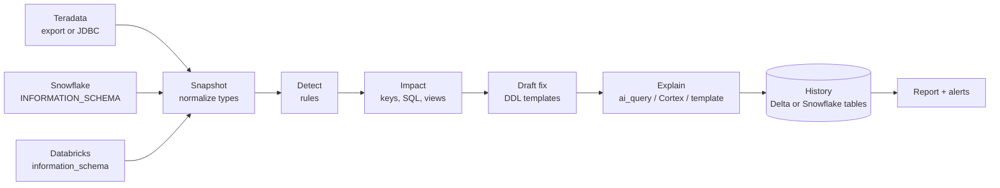

# snowdrift

**Schema drift checks you run from a Databricks or Snowflake notebook.** snowdrift compares a source system (like Teradata) with its copies in Snowflake and Databricks, flags what each change breaks, drafts the fix SQL for review, and keeps its history in your own warehouse tables.

When tables are copied from one system to others, the copies drift. Someone adds a column at the source, widens a decimal, or renames a field in one warehouse. Then the next load fails, or quietly truncates data. snowdrift catches that before the load runs.

1. **Snapshot** column definitions from every platform.
2. **Detect** differences with deterministic rules: source vs copy, final vs staging table, today vs yesterday.
3. **Assess impact** on the things that break: merge keys, stored SQL, views.
4. **Draft the fix** as quoted, reviewable `ALTER TABLE` SQL for Snowflake and Databricks. It only ever widens, and never runs anything.
5. **Explain** each change in plain English with `ai_query` (Databricks) or Cortex (Snowflake). Optional.
6. **Remember** what's new, still open, resolved or marked as noise, in Delta or Snowflake tables.

> **SQL finds the drift; AI explains it.** Detection and fix SQL are deterministic and tested. The model only sees metadata (names and types, never data) and only writes explanations. Every AI call has a template fallback.

## Requirements

| Where | Version |
| --- | --- |
| Python | 3.12 or newer |
| Databricks | Runtime 16.4 LTS or newer (Python 3.12) |
| Snowflake | Notebooks in Workspaces, set to Python 3.12. Legacy Snowflake notebooks (Python 3.9/3.10) can't load it. |
| Dependencies | None. Standard library only; it uses the notebook's own `spark` or Snowpark `session`. |

## Use it in a notebook

Start from a ready-made notebook and fill in the `<...>` placeholders:

- **Databricks:** [`notebooks/databricks_snowdrift.py`](notebooks/databricks_snowdrift.py). Import it as a notebook and schedule it as a daily job.
- **Snowflake:** [`notebooks/snowflake_snowdrift.ipynb`](notebooks/snowflake_snowdrift.ipynb). Import it into Workspaces.

The core call is the same on both platforms:

```python
from snowdrift.notebook import check
from snowdrift.sources import DatabricksSource, TeradataExportSource, spark_runner
from snowdrift.store import SparkBackend
from snowdrift.ai import AIQueryClient

report = check(
    sources={
        "teradata": TeradataExportSource("teradata", "/Volumes/main/ops/exports/teradata_columns.csv"),
        "databricks": DatabricksSource(spark_runner(spark), "main", ["sales", "stage"], work_schemas=["stage"]),
    },
    reference="teradata",
    targets=["databricks"],
    tables=["CUSTOMERS", "JOBS", "INVOICES"],
    store=SparkBackend(spark, "main.snowdrift"),  # Snowflake: SnowparkBackend(session, "DB.SNOWDRIFT")
    key_columns={"JOBS": ["JOB_ID"]},
    llm=AIQueryClient(spark, "my-endpoint"),  # Snowflake: CortexClient(session, "<model>")
)
display(spark.createDataFrame(report.to_rows()))  # one row per drift event, with the fix SQL
```

`check()` renders the report in the notebook, and returns it for alerts, tables or further work.

### Getting metadata in

| Platform | From a Databricks notebook | From a Snowflake notebook |
| --- | --- | --- |
| Databricks | `DatabricksSource(spark_runner(spark), ...)` | export `sql/databricks_columns.sql` to a stage, then `CsvSource(..., read_text=stage_reader(session))` |
| Snowflake | `SnowflakeSource(spark_reader_runner(spark, "snowflake", {...}), ...)` | `SnowflakeSource(snowpark_runner(session), ...)` |
| Teradata | export file on a Volume, or `TeradataSource(spark_reader_runner(spark, "jdbc", {...}), ...)` | export file on a stage via `stage_reader(session)` |

View definitions for the impact check come straight from the platform: `databricks_views(...)` or `snowflake_views(...)`.

### Installing

- **Databricks:** `%pip install git+https://github.com/jennigirl62/snowdrift.git`. Or upload a wheel to a Volume and `%pip install` that.
- **Snowflake:** `pip install` works if the notebook has an external access integration. Otherwise run `python tools/build_zip.py`, upload `dist/snowdrift.zip` to a stage, and add it to `sys.path` (the Snowflake notebook shows how). The zip is about 40 KB and has no dependencies.

## Try it without a warehouse

```bash
pip install git+https://github.com/jennigirl62/snowdrift.git
snowdrift demo
```

The demo runs two days of a fictional landscaping company's warehouse, with seven changes planted overnight: a new source column, a widened decimal, a widened string, a renamed column, a new NOT NULL constraint, a collation change, and a staging table that no longer matches its final table. It finds all seven.

```text
## NEW [breaking] column_missing on JOBS.CREW_LEAD (teradata vs snowflake:final)

Column missing on JOBS.CREW_LEAD: teradata has STRING(40), snowflake:final has nothing.
Breaks: SQL MERGE_JOBS. A draft fix is ready for review.

  -- DRAFT generated by snowdrift ... Review before running.
  ALTER TABLE "PUBLIC"."JOBS" ADD COLUMN "CREW_LEAD" VARCHAR(40);
```

## How it works



| Piece | File | What it does |
| --- | --- | --- |
| Notebook entry point | `notebook.py` | `check(...)`: one call that runs everything and shows the report. |
| Sources | `sources.py` | Readers for Spark, Snowpark, Spark JDBC/Snowflake connectors, DB-API, CSV on disk, Volumes or stages. |
| Type normalization | `types.py` | Maps `VARCHAR(50)`, Snowflake `TEXT(50)`, Databricks `STRING` and Teradata codes (`CV`, `I8`, `D`...) to one comparable type. |
| Rules | `rules.py` | Missing/extra columns, type, length, whole-digit and decimal precision, nullability (in the direction rows flow), order, collation, renames. |
| Impact | `impact.py` | Raises severity when a change hits a merge key, stored SQL that uses the table, or a view that names the column. |
| Fix drafts | `ddl.py` | Quoted `ALTER TABLE` drafts that only widen, or a back-up/recreate pattern when there's no safe in-place change. |
| AI | `ai.py` | `AIQueryClient` (Databricks), `CortexClient` (Snowflake), any OpenAI-compatible endpoint, or none. |
| History | `store.py` | Stable drift IDs (no daily re-alerts), new/open/resolved/false-positive tracking, 90-day snapshot retention. A source outage never resolves open drift. Backends: Delta (`SparkBackend`), Snowflake (`SnowparkBackend`), SQLite. |
| Alerts | `alerts.py` | Email, Teams adaptive card, ServiceNow (one incident per table, new breaking drift only). |

## Severity

| Change | Source vs copy | Final vs staging | Day over day |
| --- | --- | --- | --- |
| Column missing in copy | breaking | breaking | warning (dropped) |
| Type changed | breaking | breaking | warning |
| Copy shorter, or fewer whole digits / decimals | breaking | breaking | warning |
| Copy longer / wider | info | breaking | info |
| Receiving table rejects nulls the sender allows | breaking | breaking | warning |
| Possible rename (replaces the missing + extra pair) | breaking | breaking | warning |
| Hits a merge key, stored SQL or a view that names the column | raised to breaking | raised to breaking | listed, not raised |

## Outside notebooks

The same package has a command line for laptops and CI. It uses a TOML config and local SQLite history:

```bash
snowdrift run -c drift.toml --out report.md --fail-on-breaking   # exit 2 on new breaking drift
snowdrift events -c drift.toml --status open
snowdrift mark -c drift.toml <drift_id> false_positive
```

See `examples/config.example.toml` and [docs/adapting.md](docs/adapting.md).

## Development

```bash
pip install -e ".[dev]"
pytest -q          # or: PYTHONPATH=src python -m unittest discover -s tests -t tests
ruff check . && ruff format --check .
```

The tests cover the Spark and Snowpark code paths with small stand-ins for those libraries (`tests/fakes.py`). They check snowdrift's own logic, not the real platforms. Run the notebooks against a dev catalog or database before scheduling them.

## License

MIT
